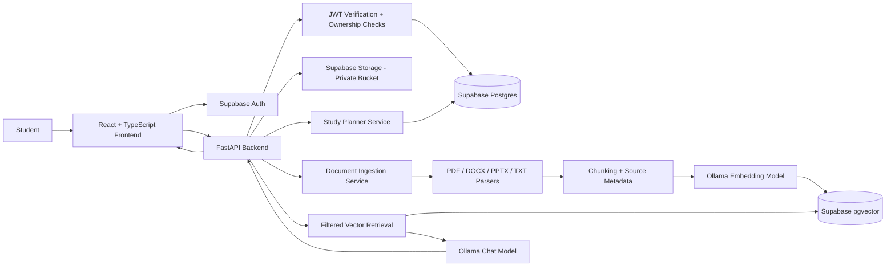

# PrepAI — System Architecture

## 1. Architecture overview

PrepAI uses a **React/TypeScript frontend + Python FastAPI modular monolith + Supabase + local Ollama** architecture.

- **Frontend:** renders pages, handles interaction, obtains a Supabase Auth session, and calls the Python API with a Bearer access token.
- **Python API:** verifies identity, checks ownership, applies planning/business rules, coordinates file ingestion, executes retrieval, calls Ollama, and returns citations and analytics.
- **Supabase:** provides Auth, Postgres data, private Storage, RLS policies, and `pgvector` vector search.
- **Ollama:** runs local chat and embedding models on the same machine or trusted private host as the backend.

The default development/runtime assumption is that the Python API can reach the local Ollama instance. Do not expose Ollama's port to the public internet.

## 2. Logical component diagram



## 3. Deployment topology and local Ollama constraint

### Supported MVP setup

- Frontend runs locally in the browser, for example on Vite's local development server.
- FastAPI runs on the same development computer.
- Ollama runs on that computer and is reachable by FastAPI at `http://127.0.0.1:11434` (or another configured local address).
- Supabase Auth, Postgres, and Storage are hosted by Supabase.

### Important deployment behavior

A deployed website does not automatically have access to Ollama running on a student's personal laptop. The browser's `localhost` refers to the visitor's own device, not the deployed API server. For remote access, either run the Python backend and Ollama on the same trusted host, or design a secure private-network/VPN solution. Do not expose Ollama directly to the internet. Document this constraint rather than silently replacing local Ollama with a cloud API.

## 4. Request flows

### 4.1 Authenticated API request

1. Student signs in through Supabase Auth.
2. Frontend obtains the current access token from the Supabase session.
3. Frontend sends `Authorization: Bearer <access_token>` to FastAPI.
4. FastAPI validates the token using the active Supabase signing/verification configuration.
5. API derives the user ID from the verified token.
6. Service queries/mutates only authorized rows. RLS is an additional security boundary, not an excuse to skip API checks.
7. API returns a response schema without private secrets or unnecessary fields.

### 4.2 Study-plan generation

1. Frontend submits planning settings or requests a replan.
2. API loads the user's subjects, unfinished syllabus topics, tasks, assessments, availability, existing sessions, and completed sessions.
3. Planner validates input and builds candidate work units.
4. A deterministic priority score is calculated from urgency, importance, difficulty, and remaining work. Weights live in one documented configuration/service, not scattered UI code.
5. Scheduler places work within declared available windows, respecting session length, breaks, blocked periods, deadlines, and completed sessions.
6. API returns a preview and a summary of scheduling decisions.
7. Student confirms; API persists the new/changed sessions transactionally where possible.
8. Dashboard, calendar, and analytics use the persisted sessions as their source of truth.

### 4.3 Document upload and indexing

1. Frontend validates the file for convenience; backend also enforces limits and supported formats.
2. File is uploaded to a private Storage path scoped by user, for example `user_id/document_id/original_filename` after the document identity is created.
3. API creates/updates a `documents` row with status `queued` or `processing`.
4. Ingestion worker/service downloads the file through authorized server-side access.
5. Parser extracts text and page/slide labels; empty extraction is a failure, not a successful index.
6. Text is chunked with stable metadata and generated chunk IDs.
7. Ollama produces embeddings locally.
8. Dimension is validated against the selected vector schema; chunks and vectors are written to Postgres.
9. Document status becomes `indexed` only after the writes complete. Failure records a safe reason and enables retry.

For the MVP, the worker may be a controlled background task only if it is reliable under expected usage. Do not rely on an untracked fire-and-forget task that silently disappears on process restart. If durable processing is needed, implement a `document_jobs` table with status, attempts, timestamps, and idempotent processing.

### 4.4 RAG question and answer

1. Student sends a question plus optional conversation and document IDs.
2. API verifies ownership of the conversation and every selected document.
3. Query embedding is created with the same embedding model used for indexing.
4. Vector search filters by the authenticated owner and selected documents; the filtering must happen in the database/query path, not only in the UI.
5. API retrieves top-k chunks, applies a configured relevance policy, and assembles bounded context.
6. Chat prompt instructs Ollama to answer from supplied context, identify unsupported questions, and associate claims with provided source IDs.
7. API resolves source IDs from trusted database metadata to produce citation objects.
8. API persists the user message, assistant response, and citation metadata.
9. Frontend renders the answer and opens source previews when the student selects a citation.

### 4.5 Replanning after changes

- Replanning must preserve completed sessions.
- Generate a preview/diff that tells the student which future sessions will move or be added/removed.
- Require explicit confirmation to apply substantial changes.
- Use stable IDs and idempotent operations to avoid duplicated sessions on retries.

## 5. Backend module boundaries

```text
backend/
  app/
    main.py
    core/
      config.py
      logging.py
      security.py
      exceptions.py
    api/
      deps.py
      routes/
        health.py
        profiles.py
        subjects.py
        topics.py
        tasks.py
        assessments.py
        planner.py
        calendar.py
        documents.py
        chat.py
        analytics.py
        notifications.py
        settings.py
    schemas/
    repositories/
    services/
      planner/
      documents/
      embeddings/
      retrieval/
      chat/
      analytics/
      notifications/
    workers/
    tests/
  migrations/
  pyproject.toml or requirements files
  .env.example
```

Keep API routes thin. Put planning, parsing, retrieval and validation in testable service functions. Keep Ollama API calls behind a single client wrapper and keep SQL/vector search behind a repository or RPC interface.

## 6. Frontend module boundaries

```text
frontend/
  src/
    app/
      router.tsx
      providers/
    components/
      layout/
      ui/
      glass/
      charts/
      feedback/
    features/
      auth/
      dashboard/
      planner/
      tasks/
      calendar/
      assistant/
      documents/
      analytics/
      settings/
    lib/
      api-client.ts
      supabase.ts
      validators/
      formatters/
    types/
    styles/
      tokens.css
      globals.css
```

Feature modules own their page-specific components and API calls; shared shell and design components live in `components/`. Do not centralize the whole application into a single component.

## 7. Data model relationships

- `profiles.id` references `auth.users.id`.
- `subjects.user_id` references the user; a subject owns `syllabus_topics`.
- `tasks` may reference a subject and optional syllabus topic.
- `assessments` reference a subject where applicable.
- `study_sessions` reference the user and may reference a subject, topic, task, or assessment.
- `documents` reference the owner and optionally a subject.
- `document_chunks` reference a document and owner; chunk vectors use the selected embedding dimension.
- `conversations` belong to a user; `chat_messages` belong to a conversation and carry citation metadata.
- `notifications` and `activity_events` belong to a user.

Use foreign keys, indexes on `user_id` and commonly filtered fields, check constraints for enums/ranges, and timestamps for traceability. Use soft-delete/archive only where the product needs recoverability; document retention semantics.

## 8. Supabase schema, RLS and vector search

- Store schema changes in versioned migrations.
- Enable RLS on user-owned tables exposed via the client.
- Policies must enforce that `auth.uid()` matches the row owner or an explicitly authorized relationship.
- Use private Storage buckets and scoped storage policies based on the upload path and authenticated owner.
- Ensure vector search cannot return another user's chunks. If the API uses privileged credentials, add explicit owner filters and test them; database-level safeguards remain preferred where the chosen architecture supports them.
- Vector dimension must match the embedding model. Changing the embedding model/dimension requires re-embedding existing content and a deliberate migration plan.
- Use parameterized SQL/RPC; never concatenate raw user input into SQL.

## 9. Scheduling engine design

### Inputs
Subjects, topics, importance, difficulty, estimated minutes remaining, deadline/exam dates, availability windows, study preferences, existing commitments, completed work, preferred session size, and break settings.

### Proposed deterministic algorithm

1. Convert incomplete tasks/topics into schedulable work units with stable IDs.
2. Exclude completed work and work already represented by valid planned sessions unless replanning explicitly replaces those future sessions.
3. Calculate an explainable priority score using configurable factors: deadline proximity, assessment relationship, declared importance, difficulty, and age/overdue state.
4. Create available time slots from the student's rules and existing blocked events.
5. Schedule higher-priority work first into the nearest suitable slots while respecting session-length caps and breaks.
6. Add revision sessions before assessments where time permits.
7. Report unscheduled work and the reason (not enough time, no availability before deadline, invalid/missing estimates).
8. Return a preview and a short reasoning summary.

Do not claim this greedy/priority-based approach is mathematically optimal. Keep weights and tie-breakers testable and configurable. The student must be able to override the plan.

## 10. Error handling and observability

- Use consistent error responses with stable error codes and safe user-facing messages.
- Log request IDs, operation names, durations, and sanitized failure categories.
- Never log credentials, complete source documents, unredacted tokens, or sensitive content by default.
- Expose a simple health endpoint that reports backend status without returning secrets. A separate dependency check may indicate whether Ollama/Supabase is reachable, but must not leak internal URLs unnecessarily.
- Add timeouts, cancellation handling, and retry rules for external/network operations.
- Keep document-processing status and job attempts observable from the UI.

## 11. Security review checklist

- [ ] Every protected API route verifies the user token.
- [ ] Owner ID comes from the verified token, not request body fields.
- [ ] Queries always scope user data by owner/authorization.
- [ ] RLS is enabled and tested on appropriate tables.
- [ ] Private Storage paths and policies prevent cross-user access.
- [ ] Service-role key and database credentials exist only on backend.
- [ ] Upload MIME type, extension, size, and parser failures are handled.
- [ ] Vector retrieval filters by owner and selected documents.
- [ ] Chat responses resolve citations from stored metadata, not model-invented labels.
- [ ] Ollama is not exposed as a public unauthenticated service.
- [ ] CORS origins are explicitly configured for local and intended deployed environments.
- [ ] Logs and error messages avoid secrets and document leakage.
