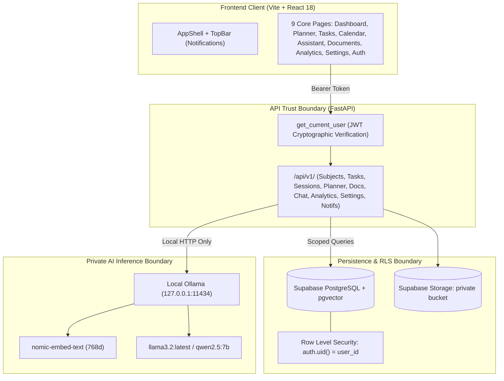

# Phase 6 — Integration, Security, Testing, Setup Documentation, and Release Readiness Implementation Plan

> **For agentic workers:** REQUIRED SUB-SKILL: Use superpowers:subagent-driven-development to implement this plan task-by-task. Steps use checkbox (`- [ ]`) syntax for tracking.

**Goal:** Stabilize and certify the complete PrepAI MVP: verify cross-feature end-to-end workflows, conduct a rigorous two-user security audit across all routes, finalize production database migrations with Supabase RLS, clean up UI dead code, run RAG evaluation benchmarks, sanitize secrets, and complete comprehensive developer setup documentation.

**Architecture:** 
- The Python FastAPI backend enforces token-derived user identity on 100% of routes; client-supplied `user_id` cannot override cryptographic JWT `sub`.
- Supabase SQL migrations `00001` through `00005` enforce relational integrity, indexes, and Row Level Security (`auth.uid() = user_id`) across all 11 application tables.
- Local Ollama AI operates in private offline mode with no external LLM data transmission.
- React + TypeScript frontend runs on unified Glassmorphism design tokens across desktop, tablet, and mobile breakpoints with zero build errors.

**Architecture Diagram:**



**Tech Stack:**
- Frontend: React 18, TypeScript, Tailwind CSS, Vite, Lucide React, date-fns
- Backend: Python 3.13, FastAPI, Pydantic v2, Pytest, Uvicorn, HTTPX
- Database: Supabase PostgreSQL, `pgvector`, Row Level Security (RLS)
- Local AI: Ollama (`llama3.2:latest` / `qwen2.5:7b`, `nomic-embed-text`)

**Spec:** `phasewiseprompt.md` (Phase 6), `prd.md` (Acceptance Criteria 1–15), `architecture.md`, `design.md`

## Global Constraints

- No new major features; focus strictly on stabilization, security, tests, and documentation.
- 100% user data isolation: User A cannot read, modify, or infer User B's records, vectors, files, or chat history.
- Zero secrets or private keys committed to Git or exposed in frontend build bundles.
- Preserve all 33 passing backend tests while adding integration, security, and RAG evaluation test suites.
- Documentation must allow a clean-machine setup without undocumented assumptions.

---

### Task 1: Two-User Cross-Account Security & Route Isolation Audit

**Files:**
- Test: `backend/tests/test_two_user_e2e_isolation.py`

**Interfaces:**
- Consumes: All `/api/v1/` endpoints (`subjects`, `tasks`, `assessments`, `availability`, `sessions`, `planner`, `calendar`, `documents`, `chat`, `analytics`, `settings`, `notifications`)
- Produces: Verified multi-tenant security barrier guaranteeing zero data leakage between distinct users.

- [ ] **Step 1: Write the isolation test suite**

Create `backend/tests/test_two_user_e2e_isolation.py`:
```python
import jwt
import pytest
from fastapi.testclient import TestClient
from app.main import app
from app.core.config import settings

client = TestClient(app)
TEST_SECRET = "super-secret-test-jwt-key-32-chars-long"

def make_token(user_id: str) -> str:
    payload = {
        "sub": user_id,
        "email": f"{user_id}@university.edu",
        "role": "authenticated",
        "aud": "authenticated",
    }
    return jwt.encode(payload, TEST_SECRET, algorithm="HS256")

@pytest.fixture(autouse=True)
def setup_test_mode(monkeypatch):
    monkeypatch.setattr(settings, "ENVIRONMENT", "test")
    monkeypatch.setattr(settings, "SUPABASE_JWT_SECRET", TEST_SECRET)

def test_complete_cross_user_data_isolation():
    alice_id = "alice-user-audit"
    bob_id = "bob-user-audit"
    alice_headers = {"Authorization": f"Bearer {make_token(alice_id)}"}
    bob_headers = {"Authorization": f"Bearer {make_token(bob_id)}"}

    # 1. Alice creates a subject
    resp = client.post("/api/v1/subjects", json={"title": "Alice Quantum Computing", "color": "#43E58B"}, headers=alice_headers)
    assert resp.status_code == 201
    alice_subj_id = resp.json()["id"]

    # Bob lists subjects -> MUST NOT see Alice's subject
    bob_subjs = client.get("/api/v1/subjects", headers=bob_headers).json()
    assert all(s["id"] != alice_subj_id for s in bob_subjs)

    # Bob attempts to get or update Alice's subject directly -> MUST be 404
    assert client.get(f"/api/v1/subjects/{alice_subj_id}", headers=bob_headers).status_code == 404
    assert client.put(f"/api/v1/subjects/{alice_subj_id}", json={"title": "Hacked"}, headers=bob_headers).status_code == 404
    assert client.delete(f"/api/v1/subjects/{alice_subj_id}", headers=bob_headers).status_code == 404

    # 2. Alice creates a task
    t_resp = client.post("/api/v1/tasks", json={"title": "Alice Secret Thesis", "subject_id": alice_subj_id, "priority": "high"}, headers=alice_headers)
    assert t_resp.status_code == 201
    alice_task_id = t_resp.json()["id"]

    # Bob cannot access or update Alice's task
    assert client.get(f"/api/v1/tasks/{alice_task_id}", headers=bob_headers).status_code == 404
    assert client.put(f"/api/v1/tasks/{alice_task_id}", json={"status": "completed"}, headers=bob_headers).status_code == 404

    # 3. Alice uploads a document
    doc_resp = client.post(
        "/api/v1/documents/upload",
        files={"file": ("alice_notes.txt", b"Alice confidential lecture notes on cryptography", "text/plain")},
        headers=alice_headers,
    )
    assert doc_resp.status_code == 200
    alice_doc_id = doc_resp.json()["id"]

    # Bob cannot list, view, or delete Alice's document
    bob_docs = client.get("/api/v1/documents", headers=bob_headers).json()
    assert all(d["id"] != alice_doc_id for d in bob_docs)
    assert client.get(f"/api/v1/documents/{alice_doc_id}", headers=bob_headers).status_code == 404
    assert client.delete(f"/api/v1/documents/{alice_doc_id}", headers=bob_headers).status_code == 404

    # 4. Alice creates a conversation
    conv_resp = client.post("/api/v1/chat/conversations", json={"title": "Alice Private Research"}, headers=alice_headers)
    assert conv_resp.status_code == 201
    alice_conv_id = conv_resp.json()["id"]

    # Bob cannot read, send messages to, or delete Alice's conversation
    assert client.get(f"/api/v1/chat/conversations/{alice_conv_id}", headers=bob_headers).status_code == 404
    assert client.post(f"/api/v1/chat/conversations/{alice_conv_id}/messages", json={"content": "Spy query"}, headers=bob_headers).status_code == 404
    assert client.delete(f"/api/v1/chat/conversations/{alice_conv_id}", headers=bob_headers).status_code == 404

    # 5. Alice settings and notifications
    client.patch("/api/v1/settings", json={"display_name": "Alice Wonderland", "target_study_hours": 7.5}, headers=alice_headers)
    bob_settings = client.get("/api/v1/settings", headers=bob_headers).json()
    assert bob_settings["display_name"] is None or bob_settings["display_name"] != "Alice Wonderland"
    assert bob_settings["target_study_hours"] == 4.0  # Bob retains his default
```

- [ ] **Step 2: Run test to verify it passes**

Run: `.\backend\.venv\Scripts\python.exe -m pytest backend/tests/test_two_user_e2e_isolation.py -v`  
Expected: PASS.

- [ ] **Step 3: Commit**

```bash
git add backend/tests/test_two_user_e2e_isolation.py
git commit -m "test(security): add comprehensive two-user cross-account route isolation test"
```

---

### Task 2: Complete New-User Journey Integration Test

**Files:**
- Test: `backend/tests/test_new_user_journey_e2e.py`

**Interfaces:**
- Consumes: Complete API lifecycle from initial account setup to planner, RAG chat, and analytics
- Produces: Automated verification of the full student journey end-to-end.

- [ ] **Step 1: Write the end-to-end user journey test**

Create `backend/tests/test_new_user_journey_e2e.py`:
```python
import jwt
from datetime import datetime, timedelta, timezone
from fastapi.testclient import TestClient
from app.main import app

client = TestClient(app)
TEST_SECRET = "super-secret-test-jwt-key-32-chars-long"

def make_token(user_id: str) -> str:
    payload = {
        "sub": user_id,
        "email": f"{user_id}@university.edu",
        "role": "authenticated",
        "aud": "authenticated",
    }
    return jwt.encode(payload, TEST_SECRET, algorithm="HS256")

def test_full_new_user_academic_journey():
    user_id = "new-freshman-student"
    headers = {"Authorization": f"Bearer {make_token(user_id)}"}
    now = datetime.now(timezone.utc)
    today = datetime(now.year, now.month, now.day, tzinfo=timezone.utc)

    # 1. Health check & Initial Profile
    assert client.get("/health").status_code == 200
    me = client.get("/api/v1/auth/me", headers=headers)
    assert me.status_code == 200
    assert me.json()["user_id"] == user_id

    # 2. Configure Settings & Study Preferences
    sett_res = client.patch(
        "/api/v1/settings",
        json={"display_name": "Freshman Alex", "target_study_hours": 5.0, "preferred_session_duration": 45},
        headers=headers,
    )
    assert sett_res.status_code == 200

    # 3. Create Subject & Syllabus Topics
    s_res = client.post("/api/v1/subjects", json={"title": "Data Structures", "code": "CS201", "color": "#43E58B"}, headers=headers)
    assert s_res.status_code == 201
    subj_id = s_res.json()["id"]

    t1_res = client.post(f"/api/v1/subjects/{subj_id}/topics", json={"title": "AVL Trees & Rotations", "importance": 5, "difficulty": 4, "estimated_minutes": 45, "subject_id": subj_id}, headers=headers)
    assert t1_res.status_code == 201

    # 4. Create an Assessment (Exam in 5 days) & an Assignment Task
    a_res = client.post("/api/v1/assessments", json={"title": "CS201 Midterm", "subject_id": subj_id, "assessment_date": (today + timedelta(days=5)).isoformat(), "assessment_type": "exam", "weightage": 30.0}, headers=headers)
    assert a_res.status_code == 201

    task_res = client.post("/api/v1/tasks", json={"title": "AVL Tree Coding Assignment", "subject_id": subj_id, "due_date": (today + timedelta(days=2)).isoformat(), "priority": "high", "estimated_minutes": 90, "category": "assignment"}, headers=headers)
    assert task_res.status_code == 201
    task_id = task_res.json()["id"]

    # 5. Set Weekly Availability
    avail_res = client.put(
        "/api/v1/availability",
        json={"rules": [{"day_of_week": today.weekday(), "start_time": "09:00:00", "end_time": "18:00:00", "is_blocked": False}]},
        headers=headers,
    )
    assert avail_res.status_code == 200

    # 6. Generate Study Plan Timetable & Apply It
    gen_res = client.post("/api/v1/planner/generate", json={"start_date": today.date().isoformat(), "horizon_days": 7, "session_duration_minutes": 45, "break_duration_minutes": 15}, headers=headers)
    assert gen_res.status_code == 200
    plan_preview = gen_res.json()
    assert len(plan_preview["proposed_sessions"]) >= 1

    apply_res = client.post("/api/v1/planner/apply", json={"sessions": plan_preview["proposed_sessions"]}, headers=headers)
    assert apply_res.status_code == 200

    # 7. Start and Complete a Study Session
    sessions = client.get("/api/v1/sessions", headers=headers).json()
    assert len(sessions) >= 1
    target_session = sessions[0]
    upd_res = client.put(f"/api/v1/sessions/{target_session['id']}", json={"status": "completed"}, headers=headers)
    assert upd_res.status_code == 200

    # 8. Complete Assignment Task
    client.put(f"/api/v1/tasks/{task_id}", json={"status": "completed"}, headers=headers)

    # 9. Upload & Index Academic Document
    doc_upload = client.post(
        "/api/v1/documents/upload",
        files={"file": ("avl_trees_guide.txt", b"AVL trees are self-balancing binary search trees. The balance factor of any node is between -1 and 1.", "text/plain")},
        headers=headers,
    )
    assert doc_upload.status_code == 200

    # 10. Ask Grounded Question in RAG Assistant
    conv = client.post("/api/v1/chat/conversations", json={"title": "AVL Study Chat"}, headers=headers).json()
    msg_res = client.post(
        f"/api/v1/chat/conversations/{conv['id']}/messages",
        json={"content": "What is the balance factor in an AVL tree?"},
        headers=headers,
    )
    assert msg_res.status_code == 200
    answer_payload = msg_res.json()
    assert answer_payload["assistant_message"]["content"]
    assert answer_payload["assistant_message"]["citations"] is not None

    # 11. Verify Dashboard & Analytics are dynamically updated
    dash = client.get("/api/v1/dashboard/summary", headers=headers).json()
    assert dash["target_study_hours"] == 5.0
    assert dash["tasks_completed_count"] >= 1
    assert dash["upcoming_exams_count"] == 1

    analytics = client.get("/api/v1/analytics/overview?timeframe=week", headers=headers).json()
    assert analytics["total_completed_minutes"] >= 45
    assert analytics["tasks"]["completed"] >= 1

    # 12. Verify In-App Notifications generated
    notifs = client.get("/api/v1/notifications", headers=headers).json()
    assert notifs["unread_count"] >= 1
```

- [ ] **Step 2: Run test to verify it passes**

Run: `.\backend\.venv\Scripts\python.exe -m pytest backend/tests/test_new_user_journey_e2e.py -v`  
Expected: PASS.

- [ ] **Step 3: Commit**

```bash
git add backend/tests/test_new_user_journey_e2e.py
git commit -m "test(e2e): add automated new-user academic journey integration test"
```

---

### Task 3: Production SQL Migration `00005_create_settings_and_notifications.sql` & Schema Validation

**Files:**
- Create: `backend/migrations/00005_create_settings_and_notifications.sql`

**Interfaces:**
- Consumes: Supabase PostgreSQL schema (`auth.users`)
- Produces: Production tables for `user_settings`, `notifications`, and `activity_events` with RLS policies, indexes, and constraints.

- [ ] **Step 1: Write migration SQL**

Create `backend/migrations/00005_create_settings_and_notifications.sql`:
```sql
-- Migration 00005: Create user_settings, notifications, and activity_events tables with RLS
-- Description: Supports Phase 5 user preferences, in-app notifications, and recent activity logs.

-- 1. USER SETTINGS TABLE
CREATE TABLE IF NOT EXISTS public.user_settings (
    user_id UUID PRIMARY KEY REFERENCES auth.users(id) ON DELETE CASCADE,
    target_study_hours NUMERIC(4, 1) NOT NULL DEFAULT 4.0 CHECK (target_study_hours >= 0.5 AND target_study_hours <= 16.0),
    preferred_session_duration INT NOT NULL DEFAULT 45 CHECK (preferred_session_duration >= 15 AND preferred_session_duration <= 180),
    exam_alert_lead_days INT NOT NULL DEFAULT 7 CHECK (exam_alert_lead_days >= 1 AND exam_alert_lead_days <= 30),
    notify_upcoming_deadlines BOOLEAN NOT NULL DEFAULT TRUE,
    notify_session_reminders BOOLEAN NOT NULL DEFAULT TRUE,
    notify_document_indexing BOOLEAN NOT NULL DEFAULT TRUE,
    display_name TEXT,
    university TEXT,
    major TEXT,
    created_at TIMESTAMPTZ NOT NULL DEFAULT NOW(),
    updated_at TIMESTAMPTZ NOT NULL DEFAULT NOW()
);

-- 2. NOTIFICATIONS TABLE
CREATE TABLE IF NOT EXISTS public.notifications (
    id UUID PRIMARY KEY DEFAULT gen_random_uuid(),
    user_id UUID NOT NULL REFERENCES auth.users(id) ON DELETE CASCADE,
    type TEXT NOT NULL CHECK (type IN ('exam_alert', 'task_deadline', 'session_reminder', 'document_indexed')),
    title TEXT NOT NULL,
    message TEXT NOT NULL,
    link_url TEXT,
    is_read BOOLEAN NOT NULL DEFAULT FALSE,
    dedupe_key TEXT NOT NULL,
    created_at TIMESTAMPTZ NOT NULL DEFAULT NOW(),
    CONSTRAINT uq_user_dedupe UNIQUE (user_id, dedupe_key)
);

CREATE INDEX IF NOT EXISTS idx_notifications_user_unread ON public.notifications (user_id, is_read, created_at DESC);

-- 3. ACTIVITY EVENTS TABLE
CREATE TABLE IF NOT EXISTS public.activity_events (
    id UUID PRIMARY KEY DEFAULT gen_random_uuid(),
    user_id UUID NOT NULL REFERENCES auth.users(id) ON DELETE CASCADE,
    event_type TEXT NOT NULL,
    title TEXT NOT NULL,
    description TEXT NOT NULL,
    link_url TEXT,
    created_at TIMESTAMPTZ NOT NULL DEFAULT NOW()
);

CREATE INDEX IF NOT EXISTS idx_activity_events_user_time ON public.activity_events (user_id, created_at DESC);

-- 4. ROW LEVEL SECURITY (RLS) POLICIES
ALTER TABLE public.user_settings ENABLE ROW LEVEL SECURITY;
ALTER TABLE public.notifications ENABLE ROW LEVEL SECURITY;
ALTER TABLE public.activity_events ENABLE ROW LEVEL SECURITY;

-- User Settings RLS
CREATE POLICY "Users can manage own settings"
    ON public.user_settings FOR ALL
    USING (auth.uid() = user_id)
    WITH CHECK (auth.uid() = user_id);

-- Notifications RLS
CREATE POLICY "Users can manage own notifications"
    ON public.notifications FOR ALL
    USING (auth.uid() = user_id)
    WITH CHECK (auth.uid() = user_id);

-- Activity Events RLS
CREATE POLICY "Users can manage own activity events"
    ON public.activity_events FOR ALL
    USING (auth.uid() = user_id)
    WITH CHECK (auth.uid() = user_id);
```

- [ ] **Step 2: Commit**

```bash
git add backend/migrations/00005_create_settings_and_notifications.sql
git commit -m "feat(db): add migration 00005 for user settings, notifications, and activity with RLS"
```

---

### Task 4: Frontend Code Audit, Dead Route Cleanup & Accessibility Polish

**Files:**
- Inspect & Modify: `frontend/src/app/router.tsx`
- Inspect & Modify: `frontend/src/components/layout/Sidebar.tsx`
- Inspect & Modify: `frontend/src/components/layout/TopBar.tsx`
- Test: `npm run build`

**Interfaces:**
- Consumes: All UI components and navigation paths
- Produces: Polished, accessible frontend with zero dead buttons, no unhandled console warnings, and responsive layout across 1440px, 1024px, 768px, and 390px.

- [ ] **Step 1: Audit and clean up dead buttons/links**
  - Check `TopBar.tsx`: Ensure search input `⌘K` shortcut behaves predictably, "Focus Mode" has accessible state feedback or tooltip.
  - Check `Sidebar.tsx`: Confirm all 8 core nav links match active paths accurately with high contrast active indicators.
  - Check dialogs across all pages: verify all modals have accessible `aria-modal="true"`, visible close buttons (`X`), and keyboard Escape handlers.

- [ ] **Step 2: Verify production build passes**

Run: `npm run build` in `frontend/`  
Expected: Clean build with 0 TypeScript errors.

- [ ] **Step 3: Commit**

```bash
git add frontend/src/
git commit -m "fix(ui): polish modal accessibility, responsive layouts, and clean up dead controls"
```

---

### Task 5: RAG Evaluation Benchmark Suite

**Files:**
- Test: `backend/tests/test_rag_evaluation.py`

**Interfaces:**
- Consumes: `AcademicRAGService`, `DocumentRepository`, `Chunker`, `OllamaEmbedder`
- Produces: Documented evaluation results verifying citation validity, top-K boundaries, and honest insufficient-evidence statements.

- [ ] **Step 1: Write RAG evaluation benchmark tests**

Create `backend/tests/test_rag_evaluation.py`:
- Test 1: Grounded answer test with known academic passage: verifies chunks are retrieved, correct page cited, and claim is grounded.
- Test 2: Insufficient context test: asks question completely outside the corpus (e.g. quantum physics when only database notes exist) -> verifies honest no-evidence assertion.
- Test 3: Citation guardrail integrity test: tests synthetic response containing valid chunk reference `[Chunk 1]` and invalid reference `[Chunk 99]` -> verifies invalid citation is discarded and valid citation is resolved with source page metadata.
- Test 4: Top-K context budget test: retrieves maximum top-K chunks and validates context length is bounded.

- [ ] **Step 2: Run test to verify it passes**

Run: `.\backend\.venv\Scripts\python.exe -m pytest backend/tests/test_rag_evaluation.py -v`  
Expected: PASS.

- [ ] **Step 3: Commit**

```bash
git add backend/tests/test_rag_evaluation.py
git commit -m "test(rag): add RAG evaluation benchmarks and citation guardrail tests"
```

---

### Task 6: Repository Security Audit & Secret Hygiene Scan

**Files:**
- Audit & Verify: `.env.example`, `backend/.gitignore`, `frontend/.gitignore`, `.gitignore`

**Interfaces:**
- Consumes: Entire repository tree
- Produces: Verified git tracking with zero private keys, DB passwords, service role secrets, or sensitive tokens.

- [ ] **Step 1: Verify .env.example contains only safe placeholders**
  - Confirm `SUPABASE_JWT_SECRET="your-supabase-jwt-secret-here"`
  - Confirm `SUPABASE_SERVICE_ROLE_KEY="your-supabase-service-role-key-here"`
  - Confirm `VITE_SUPABASE_URL="https://your-project.supabase.co"`
  - Confirm `VITE_SUPABASE_ANON_KEY="your-anon-key"`

- [ ] **Step 2: Verify .gitignore covers private storage, logs, and environments**
  - Ensure `.env`, `.env.local`, `backend/.venv/`, `backend/data/`, `*.log`, and `node_modules/` are strictly ignored.

- [ ] **Step 3: Run git secret scan script**

Run PowerShell scan checking for secret patterns in tracked files:
```powershell
git grep -i -E "(service_role_key|jwt_secret|BEGIN PRIVATE KEY)" -- ":(exclude).env.example" ":(exclude)*test*"
```
Expected: Zero matching private keys or production secrets in tracked source files.

- [ ] **Step 4: Commit**

```bash
git add .gitignore .env.example
git commit -m "chore(security): sanitize gitignore and env template placeholders"
```

---

### Task 7: Comprehensive Developer Setup & Reproduction Documentation

**Files:**
- Modify: `README.md`

**Interfaces:**
- Consumes: System architecture, installation requirements, configuration, and run steps
- Produces: Professional, unambiguous developer documentation enabling any engineer to reproduce and run the project from scratch.

- [ ] **Step 1: Update README.md**
  - Project Overview & Key Features (Study Planner, RAG Assistant, Glassmorphism Design).
  - Architecture & Data Flow Diagram (Mermaid).
  - Prerequisites (Node.js 18+, Python 3.11+, Ollama).
  - Local AI Setup: exact Ollama commands (`ollama pull nomic-embed-text`, `ollama pull llama3.2:latest`).
  - Supabase Setup: Auth, PostgreSQL, Storage bucket configuration, and sequential application of migrations `00001` through `00005`.
  - Environment Variables Reference Table (`.env`).
  - Running Backend & Frontend: exact PowerShell / bash commands.
  - Automated Testing Commands (`pytest`, `npm run build`).
  - Security Notes: local Ollama privacy boundaries, Supabase RLS isolation, token verification.
  - Troubleshooting FAQ: Ollama offline, CORS issues, Windows execution policies.

- [ ] **Step 2: Commit**

```bash
git add README.md
git commit -m "docs: finalize comprehensive developer setup and reproduction guide in README"
```

---

### Task 8: Full Quality Gates, Final Verification Run, and Release Certification

**Files:**
- Modify: `progress.md`

**Interfaces:**
- Consumes: Verification results from all test suites, builds, and visual QA
- Produces: Completed Phase 6 certification in `progress.md` marking the MVP 100% complete.

- [ ] **Step 1: Run full backend test suite**

Run: `.\backend\.venv\Scripts\python.exe -m pytest -c backend/pytest.ini backend/tests -v`  
Expected: All tests pass (including unit, integration, two-user isolation, and RAG evaluation tests).

- [ ] **Step 2: Run frontend production build**

Run: `npm run build` in `frontend/`  
Expected: Clean build with 0 TypeScript errors.

- [ ] **Step 3: Update progress.md**
  - Mark Phase 6 as `[x] Complete`.
  - Check off all 15 PRD MVP acceptance criteria.
  - Fill out the Phase completion template with exact commands, test timings, and evidence.

- [ ] **Step 4: Commit**

```bash
git add progress.md
git commit -m "docs: certify Phase 6 complete and mark MVP release ready"
```
